---

title: MQTT - Um Guia  
description: Explicação de todos os aspectos em torno do uso do MQTT em Meshtastic

---
## Se tem pressa
O MQTT é um protocolo de troca de mensagens numa rede TCP/IP (local ou Internet). O Meshtastic pode ter alguns rádios ligados a um servidor MQTT e pode passar mensagens por rádio frequência (RF) e por MQTT. O ojectivo do MQTT é aumentar o alcance da rede para pontos onde o RF ainda não chegue, ou em situações de calamidade ou catástrofe permitir ter uma rede híbrida com o maior alcance possível. Serve também para monitorização da rede, recepção de informação para identificar nós, localizá-los no mapa e outras possíveis integrações.

A ligação ao MQTT é totalmente opcional.  
Há forma de indicar que não queremos usar MQTT e existem canais de mensagens onde não é sequer possível usar MQTT.  
É possível identificar as mensagens que passaram por MQTT e fazer testes que excluem o MQTT.

## Para que serve o MQTT numa rede RF?

A pergunta faz todo o sentido e à primeira vista pode parecer um erro ou "batota". E para sermos claros o tema não é pacífico. Listamos algumas das vantagens de ter MQTT numa rede que se pretende alternativa:

*   O MQTT pode servir para monitorizar e estudar a rede. Isto é prática habitual mesmo em redes mesh que não permitem a passagem de mensagens por MQTT.
*   O MQTT permite ligar zonas isoladas onde o sinal RF ainda não chegue. Isso permite desenvolver a rede num local, levando mais pessoas a aderir o que expandirá o raio de cobertura de sinal RF dessa zona, levando em última instância à junção de zonas, ponto a partir do qual o MQTT se poderá tornar dispensável.
*   Num caso de calamidade ou catástrofe é muito natural que o que funcionava bem em RF possa ter quebras de continuidade devido à destruição ou avaria de rádios que faziam a ligação a outras zonas. Com a complexa cobertura de internet, há vários operadores e alternativas aos serviços tradicionais, usando satélites por exemplo, como a Starlink. A multiplicidade de meios de acesso aumentam a probabilidade que mesmo com cortes severos (como aconteceu em 2026 com a tempestade Kristin) existam pontos que mantenham a conectividade. Ou porque por sorte umas antenas 4G/5G não foram afectadas, ou porque a zona tem fibra enterrada, ou porque há utilizadores de Starlink (juntas de freguesia por exemplo). Havendo pontos com conectividade, se houver ainda uma rede mesh com o RF minimamente operacional a nível local, um utilizador Meshtastic que tenha acesso à Internet, pode através do MQTT, fazer a ponte com o resto da rede. Como alguém comentava numa das inúmeras discussões sobre o MQTT: "Se eu estiver enrascado, se conseguir pedir ajuda, quero lá saber se passou por MQTT/Internet, por sinais de fumo ou se foi só por RF". O objectivo é construir uma rede híbrida, que não dependa de Internet, mas que a possa utilizar se estiver disponível, para aumentar o seu alcance.
*   O MQTT pode ser uma interface muito prática para integrar serviços extra na rede."Robots" de ajuda e outros mecanismos podem ser mais fáceis de desenvolver e mais fiáveis (garantindo maior cobertura) se usarem este método alternativo se interação.
*   O MQTT pode servir para encaminhar tráfego que não deva ocupar a rede RF (pelos escassos recursos que esta oferece). Imagine-se uma rede mesh semi-privada numa zona rural que pode estar até a trabalhar num modo diferente da rede Meshtastic geral. Para efeitos de recolha de dados de sensores, tracking de pessoas ou animais ou outra utilização desse género. A zona de recolha de dados pode não ter cobertura de Internet, ou ser demasiado dispendioso ou necessitar de demasiada energia usar aparelhos com capacidade de comunicar directamente via Internet. Mas essa zona de recolha pode eventualmente conseguir enviar os dados usando LoRa até uma zona com cobertura, e onde pode estar um rádio com acesso a um servidor MQTT. A partir daí os dados podem usar a Internet, e não serem um peso para a rede LoRa. No fundo permite uma utilização híbrida, podendo levar comunicação até onde não haja ou não seja conveniente ter cobertura Internet.
*   O MQTT pode ser usado a título privado para integração com outros sistemas. Cada utilizador tem a liberdade de configurar um rádio seu para se ligar a um servidor de MQTT que pode ser público ou privado. Isto permite a integração da rede mesh com outros sistemas como Home Assistant usando um protocolo standard.
*   O MQTT pode ser usado como interface entre dois segmentos de uma Mesh, que estejam segregados, por exemplo por operarem em frequências diferentes (868 Mhz, 433 Mhz ou 2.4Ghz) ou até em presets diferentes (Longfast e outro(s))

## Então o MQTT só tem vantagens?

Não! Embora os problemas de ter MQTT não seja o facto em si, mas a forma como se usa. E há de facto críticas válidas ao uso de MQTT. A resposta a essas críticas não deve ser não implementar, mas sim implementá-lo e usá-lo de forma consciente dos efeitos que tem, e sabendo como eliminar ou mitigar as desvantagens. Estas serão algumas das desvantagens do MQTT:

1.  É confuso para a maioria dos utilizadores. Essencialmente porque aumenta a complexidade do sistema (como quase sempre acontece quando se introduz algo que aumenta a flexibilidade). Este documento é uma tentativa de explicar os vários aspectos do MQTT.
2.  Dá uma falsa sensação de alcance. As redes LoRa dependem muito da linha de vista, altitude, antenas e ruído electro-magnético na zona. Um utilizador que compre um rádio, faça as configurações sugeridas e se enfie numa cave onde tenha acesso à Internet pode de repente começar a chegar a todo o lado... Mas mais tarde ou mais cedo, irá perceber que com a antena de 5cm que veio com o rádio e acomodado no sofá da cave, só conseguirá comunicar por MQTT/Internet. E certamente não foi isso que procurou ao aderir à mesh. E daí resulta uma de duas coisas: Ou sai cá para fora e começa a procurar ligações, e eventualmente a ajudar a expandir a rede, ou fica desiludido e encosta o rádio.
3.  Torna os testes e o desenvolvimento da rede RF mais complexo.
4.  Diferentes aplicações podem dar mais (Android) ou menos (iOS) visibilidade à utilização de MQTT nas mensagens
5.  Conforme as regras definidas no servidor MQTT, um rádio que se ligue ao MQTT pode receber demasiado tráfego que irá tentar retransmitir. Isso pode levar a uma utilização demasiado alta podendo ficar "bloqueado" por atingir o duty cycle, perder oportunidade de escuta, por estar a transmitir com demasiada frequência e "poluir" o sinal RF da zona com excesso de tráfego

## MQTT no Meshtastic

O Meshtastic em geral permite que qualquer rádio com acesso a uma rede TCP/IP possa ser conectado a um servidor MQTT. É importante distinguir a funcionalidade base do firmware das múltiplas utilizações possíveis. Para não alongarmos (ainda mais) este documento vamos focar-nos na utilização do MQTT na rede Meshtastic em Portugal:

> O servidor (ou servidores) são mantidos e geridos pela equipa de curadores do Meshtastic.pt.

>O servidor MQTT aceita ligações usando um utilizador e palavra-chave conhecidos. 

>As mensagens são publicadas nos seu formato encriptado  Como tal, o tráfego enviado ao MQTT tem a mesma segurança que o que circula via RF.

>O MQTT permite o envio (Uplink) e a recepção (Downlink) de mensagens sem alterações. Em outras redes Meshtastic não é permitido o Downlink (Espanha), ou o número de Hops disponíveis em Downlink é alterado para zero, impedindo assim a sua retransmissão por RF (servidor internacional).

>O tráfego que chega ao MQTT é temporariamente armazenado e disponibilizado num sitio na Internet: [Malha](https://malha.meshtastic.pt) muito útil na monitorização e estudo da rede. As mensagens de canais públicos podem ser consultadas por quem não é utilizador da rede, algo que qualquer pessoa com um aparelho SDR (*software defined radio*) poderia fazer.

>Os donos de rádios podem definir que canais decidem enviar ou receber para o/do MQTT. Os rádios só enviam para o MQTT os canais que conheçam e as mensagens ponto a ponto.

>Qualquer utilizador tem a liberdade de indicar que não quer as suas mensagens enviadas para o MQTT. Mas há duas coisas a ter em conta:
>
>1.  Se o servidor configurado num rádio tiver um endereço "privado" (para os "techies", isto significa ter um endereço nas redes que não são "roteáveis" na Internet como 10.x.x.x, 192.168.x.x, 172.16 .x.x a 172.31.x.x) esta "indicação" da origem não é respeitada (as mensagens podem ser enviadas, mesmo que o utilizador dê a indicação que não). 
>2.  Expandido o tema acima, e sendo o Meshtastic um sistema de código aberto, é sempre possível alterar o firmware para não respeitar esta indicação. Como em muitos outros aspectos, isto é uma rede cooperativa e está altamente exposta a comportamentos diferentes dos formalmente propostos.

> Qualquer utilizador tem a liberdade de recusar tráfego que tenha passado pelo MQTT (não recomendado, explicado noutra secção).

>A comunicação entre o rádio e o MQTT necessita de uma ligação TCP/IP. Essa ligação pode ser directa, para rádios que tenham rede (WiFi por exemplo) ou feita através da aplicação usando o que se chama "proxy do cliente".

>O servidor MQTT em uso em Portugal tem restrições geográficas. Em princípio só permite ligações de pontos nacionais. Isto pode impedir a utilização directa a viajantes Portugueses no estrangeiro, sendo naturalmente possível usar uma VPN nacional para efectivar a ligação. Estas limitações foram impostas na sequência de ataques de SPAM feitos ao serviço.

>O servidor MQTT em uso em Portugal tem mecanismos preventivos de SPAM malicioso ou por má configuração. Se um rádio estiver constantemente a enviar a posição por exemplo o servidor pode reduzir a cadência de pacotes que deixa passar para os subscritores.

## Como passam as mensagens no MQTT?

Conforme explicado acima, as mensagens podem ser enviadas para o MQTT por um rádio que tenha acesso a rede TCP/IP, mediante várias condições. Esse rádio pode ser o emissor ou qualquer outro que sirva a rede e retransmita pacotes. Daí uma distinção "baptizada" em Portugal:

### MQTT activo e MQTT passivo

Activo

> Diz-se que usamos MQTT activo quando o nosso rádio está configurado para se ligar ao MQTT. As mensagens que escrevemos ou recebemos para re-envio serão emitidas por RF e logo de seguida enviadas para o MQTT. O nosso rádio receberá também mensagens do MQTT directamente.

Passivo

> Neste caso o nosso rádio não está ligado ao MQTT. Faremos o envio ou a retransmissão de mensagens apenas via RF e não recebemos nada do servidor MQTT. Mas devemos configurar a opção "Disponibilizar no MQTT", e isso marcará as nossas mensagens com um sinal que podem ser enviadas para o MQTT. Essas mensagens ao chegarem a um rádio com MQTT activo poderão ser enviadas por esse rádio para o MQTT.
> 
> Se configurarmos o "Disponibilizar no MQTT" como desligado, estaremos a dar a indicação aos rádios em MQTT activo, que não queremos que façam Uplink das nossas mensagens. Em relação às mensagens que recebemos e retransmitimos, é transparente: Não enviamos ao MQTT e naturalmente não mudamos a marcação da mensagem ("Disponibilizar no MQTT" on/off) definido pelo emissor

## Configuração

### MQTT activo no Android
Aceder à configuraçao, procurar por módulos e escolher o módulo MQTT:

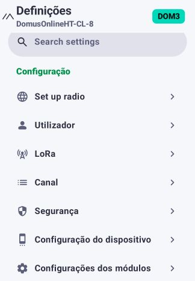

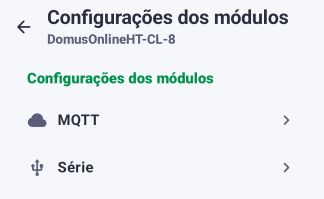

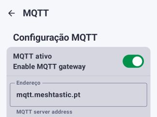

Para activar o proxy pelo telefone (nós sem WiFi):

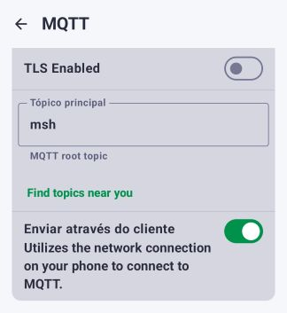

### MQTT activo no iOS
Nas configurações, aceder às configurações dos módulos e escolher o MQTT:

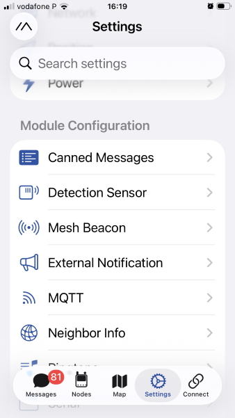

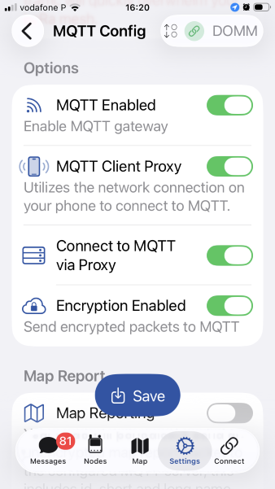

### Ignorar MQTT

O Meshtastic disponibiliza também uma configuração que indica ao rádio que deve descartar qualquer mensagem que receba e que já tenha passado pelo MQTT. Os rádios conseguem ver isto, pois nos metadados das mensagens vem um campo que sinaliza se a mensagem já passou pelo MQTT. Este campo está marcado como "false" à partida. E assim se mantém até que um rádio a envie para o MQTT. O rádio que faz o Downlink muda-o para "true" antes de a retransmitir por RF, informando assim todos os seguintes rádios que a mensagem passou pelo MQTT. Podemos ver este campo na opção de depuração na opção Android (via_mqtt=false):

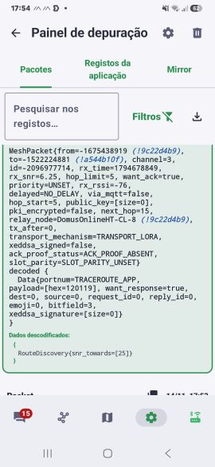

Configuração de "Disponibilizar no MQTT" e "Ignorar MQTT" em Android:

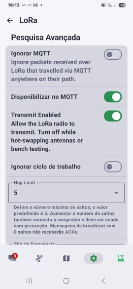

Configuração de "Disponibilizar no MQTT" e "Ignorar MQTT" em iOS:

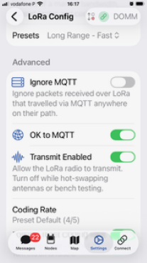

### Configuração de canais

Na configuração de canais, quando os adicionamos temos duas opções: Uplink e Downlink (traduções para Portguês ainda inconsistentes). Estas opções só são relevantes nos rádios que tenham MQTT Activo. **Se não estivermos ligados ao MQTT estas opções não têm qualquer efeito**. Estas opções controlam, ao nível do canal, se o rádio envia (Uplink) ou recebe (Downlink) mensagens para ou do MQTT. Há uma confusão frequente que sugere que o emissor, ao não marcar o Uplink, condiciona os rádios na rede a não enviarem as mensagens que origina naquele canal para o MQTT. **Isto não funciona assim. Não temos controlo ao nível do canal. Só ao nível geral com o "Disponibilizar no MQTT"**.

Portanto quem define se as mensagens de um canal são enviadas para o MQTT é o dono de cada rádio ligado ao MQTT (Activo), não se sobrepondo isto à sinalização que venha na mensagem (se vier sem "Disponibilizar no MQTT", o rádio ter marcado o Uplink no canal não dita o envio da mensagem)

Este é o motivo porque activar a opção de ignorar o tráfego que passou pelo MQTT é perigosa: Porque nós não controlamos a decisão dos outros, se alguém decide fazer o Uplink de uma mensagem, então a velocidade de propagação dessa mensagem será muito maior por MQTT que por RF. Isto quer dizer que uma mensagem que chegue a um nó por MQTT, se chegar por RF, será tendencialmente mais tarde. E chegando mais tarde será descartada como duplicada. Entretanto esse rádio já a terá retransmitido e quem a ignorar não a verá por RF muito provavelmente. Como referido noutra secção há formas mais eficazes de operar só em RF.

Configuração de Upllink e Downlink em canais em Android:

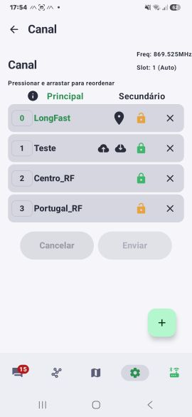

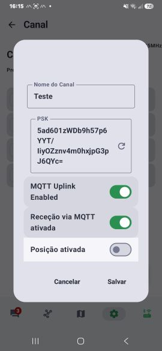

Configuração de Upllink e Downlink em canais em iOS:

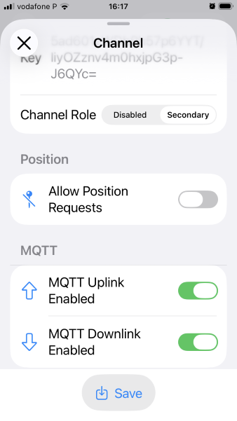

### Matriz de envio ao MQTT

Dada a complexidade do tema vamos tentar ver numa tabela quando uma mensagem em canais será enviada ao MQTT ou não:

| **Configuração do Emissor** | **Emissor Activo** | **Emissor Passivo** | **Hop c/ Uplink no canal** | **Hop s/ Uplink no canal** |  
| --- | --- | --- | --- | --- |
| **OK to MQTT OFF** | n/a (ver Uplink) | Não Envia | Não Envia | Não Envia |  
| **OK to MQTT ON** | n/a (ver Uplink) | Não Envia | Envia | Não Envia |  
| **Uplink no canal ON** |  Envia | Não Envia | n/a (Ver OK to MQTT) | Não Envia |  
| **Uplink no canal OFF** | Não Envia | Não Envia | n/a ( Ver o OK to MQTT) | Não Envia |

As mensagens privadas são tratadas de forma ligeiramente diferente. Não estando num canal não há um "Uplink/Downlink" associado a elas, e por opção no código do firmware, são enviadas se o MQTT receber mensagens encriptadas (que é o caso em Portugal).

Parece muito complexo? Então simplifiquemos numa só frase: Uma mensagem só será enviada ao MQTT se o node emissor estiver como activo e tiver o Uplink no canal (ou se fôr uma mensagem privada), ou se o node que a vai retransmitir tiver o canal definido, tiver Uplink no canal e o emissor tiver "Disponibilizar no MQTT" "on" (ou se fôr uma mensagem privada).

Outras formas de colocar o tema:

*   Um rádio sem o MQTT configurado não envia mensagens para o MQTT
*   Uma mensagem num canal, criada com o "Disponibilizar no MQTT" desligado não é enviada para o MQTT
* Uma mensagem privada é enviada para o MQTT se este estiver a receber tráfego encriptado (situação em Portugal)
*   Um rádio retransmissor não envia para o MQTT canais que não tenha configurados
*   O Uplink e Downlink são relevantes apenas no rádio que liga ao MQTT, não em rádios sem MQTT ou com MQTT passivo

## Eu quero RF! Como sei se está a funcionar?

Este é um ponto muito importante. O MQTT é bom se a rede RF funcionar. Mas ninguém quer estar dependente de MQTT/Internet, pois isso é  um contra-senso numa rede que sirva de alternativa para emergências.

Daqui salta a necessidade óbvia de ter visibilidade e entender o MQTT. Esta necessidade ocorre em várias situações que tentamos abordar agora.

### MQTT em mensagens

Um dos requisitos básicos é podermos entender se uma mensagem que nos chega passou ou não pelo MQTT. Infelizmente a resposta depende da plataforma que usamos. Na aplicação "Android" (incluí versões para Windows e Linux) e no cliente Web isto é extremamente fácil. Infelizmente em iOS não há forma de ver se uma mensagem passou por MQTT. Em Android:

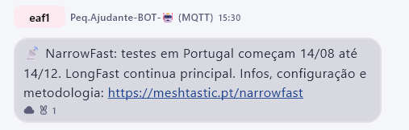

No rodapé da mensagem, assumindo que não foi directa (nesse caso mostraria níveis de SNR e RSSI) temos o símbolo de "hops" (o coelho) À sua direita temos o número de hops, e se tiver passado por MQTT teremos uma nuvem à esquerda. Portanto, a mensagem acima passou pelo MQTT. Note-se que passar por MQTT não implica que a mensagem não possa chegar só por RF.

Uma confusão muito frequente, é assumir que se o nome do emissor tiver "(MQTT)", então a mensagem passou por MQTT. Isso é incorrecto. Para nós termos o nome dos rádios temos de receber uma informação deles chamada NodeInfo. O NodeInfo é uma mensagem normal que "anuncia" o rádio à rede, e se recebermos essa mensagem específica com passagem pelo MQTT o rádio fica com "(MQTT)" no nome. Mas outras mensagens enviadas pelo rádio podem passar ou não por MQTT. Aliás, pode acontecer o contrário: Recebemos o NodeInfo sem passagem por MQTT, logo o rádio não terá "(MQTT)" no nome, e depois recebemos mensagens desse rádio que passam por MQTT. Portanto a forma de ver é no rodapé de cada mensagem e cada mensagem pode ter um caminho distinto, até porque as posições dos rádios podem mudar.

Aqui podemos ver uma mensagem que não passou pelo MQTT:

Como se pode verificar no rodapé, não temos a nuvem.

### MQTT em Traços de rota

Quando estamos a testar se chegamos a determinado ponto é muito habitual usarmos o mecanismo de traçar rotas. O *trace* funciona enviando uma mensagem a um rádio de destino, sendo que, todos os rádios que sirvam de "hop" se vão registando nessa mensagem, e indicando o nível de SNR com que receberam do rádio anterior. Chegando ao destino, esse cria um pacote de resposta, e os hops na volta vão-se adicionando, bem como o SNR com que receberam. Eis um exemplo de um trace:

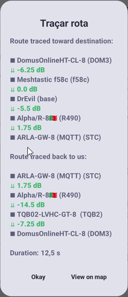

Ora, um rádio que faça o Downlink de uma mensagem do MQTT, não terá SNR associado, pois isso só existe em RF. Sendo assim, colocou-se o problema de como representar isso? Infelizmente a decisão foi mostrar "0.0 dB" como aparece no segundo salto. Infelizmente porquê? Em LongFast o SNR varia entre cerca de -21dB até cerca de 7.5dB. O valor varia portanto entre um valor negativo e um valor positivo. Ora sendo assim, por regra matemática, o 0.0 é um valor possível. A precisão usada (0.25dB) implica que para o intervalo apresentado teremos 114 valores possíveis, o que estatisticamente faz com que 0.0dB tenha uma probabilidade baixa de ocorrer (assumindo que todos os valores teriam a mesma probabilidade o que não será verdade). Mas em todo o caso é um valor válido, pelo que a sua escolha foi um erro, por poder causar interpretações dúbias. Mas na maioria dos casos, quando vemos um salto de 0.0dB num trace, é muito provável que tenha sido um salto via MQTT. Na imagem acima, o rádio "Mesthtastic f58c" fez o Uplink e o "DrEvil" fez o Downlink.

Já houve tentativas de corrigir isto e não está descartada a possibilidade que ainda de venha a corrigir, permitindo mostrar "MQTT" em vez de um valor em dBs.

**Nota**: Foge um pouco ao tema, mas o Meshtastic também pode encaminhar mensagens por UDP (variante do TCP/IP) e esses saltos são também representados por 0.0dB nos traces. Um salto por UDP não activa a nuvem no rodapé das mensagens.

Por curiosidade, e chamando a atenção para que uma mensagem não pode passar duas vezes pelo MQTT podemos ver este trace curioso:

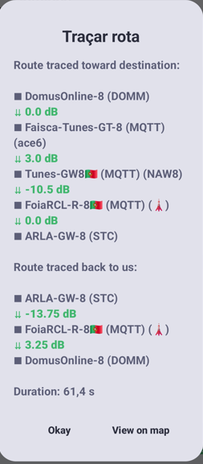

Como se pode reparar, existem dois saltos com 0.0dB. E como referido, uma mensagem não pode passar duas vezes pelo MQTT. Neste caso sabemos que o primeiro salto foi por MQTT e o último da ida foi por RF, sendo um dos raros casos onde um 0.0dB num trace representa um salto RF.

## Utilização sem MQTT

A recomendação em Portugal é usar o MQTT passivo, ou activo caso não tenha ligação RF à rede. Mas surge sempre a necessidade de fazer testes para desenvolver a conectividade RF, ver onde chegamos e ajudar a melhorar a rede. E eventualmente podemos não querer que as nossas mensagens vão parar ao sitio Malha. Tudo isto são motivos para evitar o uso de MQTT. Seguem-se algumas dicas para utilização sem MQTT e para testes:

### Enviar mensagens sem MQTT

Basta não configurar o MQTT como activo (ou se tivermos como activo sermos criteriosos com o Uplink e Downlink dos canais) e não activar o passivo (Disponibilizar no MQTT a "off"). Note-se como referido anteriormente que, activar o "Ignorar MQTT" pode levar ao isolamento pois a nossa decisão não controla a decisão dos colegas de rede. Isto para canais "normais".  
Refira-se ainda que ao desactivar o "Disponibilizar no MQTT" estamos a assumir que não queremos chegar a colegas que estejam em "ilhas de RF" dependentes de conexão ao MQTT.

### Usar canais "só" RF

Neste momento e após vários pedidos, o servidor MQTT em Portugal recusa mensagens para qualquer canal cujo nome termine em _RF. Pode consultar a lista de [canais comunitários](https://meshtastic.pt/channels) . Esta funcionalidade, à data da escrita, está em Beta, mas sem problemas conhecidos. Note-se que qualquer grupo de utilizadores pode acordar ter um canal "só RF" se todos se comprometerem a não activar o Uplink e Downlink para esse canal. O efeito é o mesmo, mas é reconfortante saber que o servidor força a que se respeite a convenção de ter canais exclusivos em RF. Para além dos canais com nome terminado em "_RF" também o canal do [plano 333](https://plano333.pt/mesh-3-3-3/) está barrado no MQTT

### Traçar rota sem MQTT

O objectivo de traçar rota é ver se chegamos a um nó. Mas na realidade o trace só nos é retornado se fôr e voltar. Pode só chegar, e se a resposta não nos chegar não temos visibilidade que chegou. Uma forma de testar caminhos RF e ao mesmo tempo maximizar a possibilidade de o traço de rota se concluir com sucesso é:

1.  Desligar o MQTT Activo (evita que enviemos a mensagem pelo MQTT)
2.  Desligar o "Disponibilizar no MQTT" (evita que outros rádios enviem a nossa mensagem para o MQTT)
3.  Garantir que o "Ignorar MQTT" está desligado (permite que a resposta passe por MQTT)

Isto permite que o caminho de ida (o que controlamos) seja feito só em RF e que o de volta possa ter MQTT. Se tiver sucesso sabemos que há um caminho RF (mostrado na ida) e aumentamos as possibilidades de ter sucesso no regresso.

Sabendo que os traços de rota se fazem no canal primário, podemos ainda maximizar mais fazendo:

1.  Ligar o MQTT Activo (permite ligar o Downlink para receber directo do MQTT)
2.  Desligar o Uplink no canal primário (garante que não enviamos o trace por MQTT)
3.  Ligar o Downlink no canal primário (garante que podemos receber directamente do MQTT a resposta, encurtando caminhos)
4.  Desligar o "Disponibilizar to MQTT" para impedir que outros "hops" enviem para o MQTT
5.  Garantir que o "Ignorar MQTT" está desligado (para permitir que a resposta passe pelo MQTT)

### Traçar rotas em canais "só RF"

Esta dica é um pouco mais técnica... e infelizmente não há um comportamento uniforme entre as várias aplicações. Por norma, as mensagens de trace são enviadas no canal primário. Mas há excepções. O objectivo é garantir que tanto a ida como a volta são feitas apenas com RF, e em diferentes clientes a escolha do canal usado para enviar o traço de rota pode variar: [Traceroute Module Usage](https://meshtastic.org/docs/configuration/module/traceroute/#channels-and-encryption)

Segundo o referido neste documento:

| **Cliente** | **Canal usado** |
| --- | --- |
| CLI | Canal 0, ou --ch-index se usado |
| iOS | Sempre no canal 0 |
| Android | O canal onde o destino foi ouvido a última vez, ou o canal 0 |
| Cliente Web | Canal pimário |
| Menu rádio | Canal 0 |

Ora, o Android é o mais esquisito de todos, mas o que nos interessa é o CLI. Com o CLI podemos escolher o canal de envio com a opção --ch-index:

> mesh@meshhost: ./meshtastic --host domusonlineht-cl-8 --ch-index 6 --traceroute '!a544b10f'  
> Connected to radio  
> Sending traceroute request to !a544b10f on channelIndex:6 (this could take a while)  
> Route traced towards destination:  
> !9c22d4b9 --> !a544b10f (6.25dB)  
> Route traced back to us:  
> !a544b10f --> !9c22d4b9 (6.5dB)  
> mesh@meshhost:

A configuração dos canais na origem (canal 6 é o Portugal_RF):

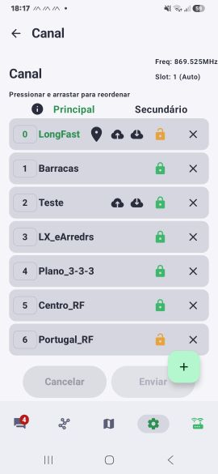

Configuração dos canais no destino (Portugal_RF é o canal 3):

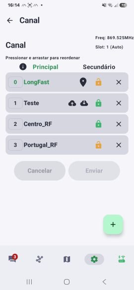

E o debug da mensagem no destino, indicando o canal 3:

/